<p align="center">
  
</p>

<p align="center">
  Solo practice for system design and machine-coding interviews, against an AI interviewer, with a judge and a coach.
</p>

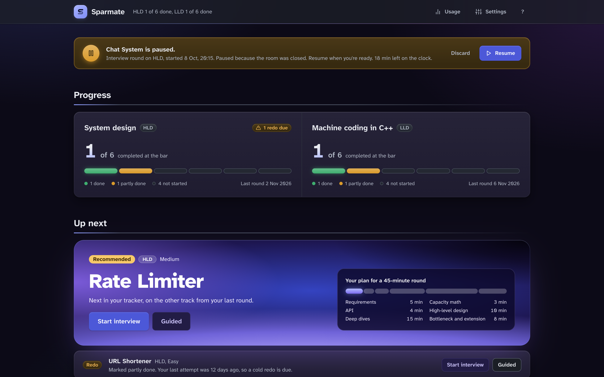

## What it does

- **HLD rounds.** A timed system design round on a whiteboard. The board has one frame for each step of the round.
- **LLD rounds.** A timed machine-coding round in a C++ editor. You compile and run your code in the page.
- **Interview or guided mode.** Interview mode gives no help on the clock, like the real thing. Guided mode walks the steps with you and gives hints.
- **A judge's debrief.** The judge scores the round against your target level and quotes your own words as evidence.
- **A coach.** The coach teaches the gaps the judge found, using your study folder's rules.
- **Study-note drafts you approve.** The app drafts edits to your notes. You pick what to keep. Nothing is written before you click Save.
- **Voice in and out.** Speak your answers and hear the interviewer's replies.
- **A weekly plan.** Today picks the session for the day from your plan: a redo, a new problem, a DSA day or rest.
- **DSA progress.** The Progress page counts your LeetCode solves from a day you choose, against your weekly goal. It reads your public profile through LeetCode's unofficial GraphQL endpoint, so it can change, and it needs no login.
- **Drills.** Under Practice, short graded drills of 10 to 15 minutes, queued from the gaps in your debriefs, in six kinds: capacity math, walk a request, requirements sprint, pick a deep dive, defend a trade-off and an LLD skeleton. A grader scores named criteria from 1 to 4 and gives Interview-ready, Getting there or Needs work, with one revision for a written drill, and the deep dive and the trade-off run as a dialogue with one or two follow-up questions. Each repeat uses another problem or a changed constraint, a drill closes after three Interview-ready results on at least two problems, and every attempt is saved in the drill's history.
- **Progress.** One focus skill each week, your level per skill (your latest rounds, with drills counted at a lower weight), the results of each drill kind, the redo queue and your round history.
- **A command palette.** Press ⌘K (Ctrl+K elsewhere) to jump to a page, a problem or a past round.
- **A usage page.** See tokens and cost for each round, role and model.

| Today                                                     | Debrief                                          |
| --------------------------------------------------------- | ------------------------------------------------ |
| 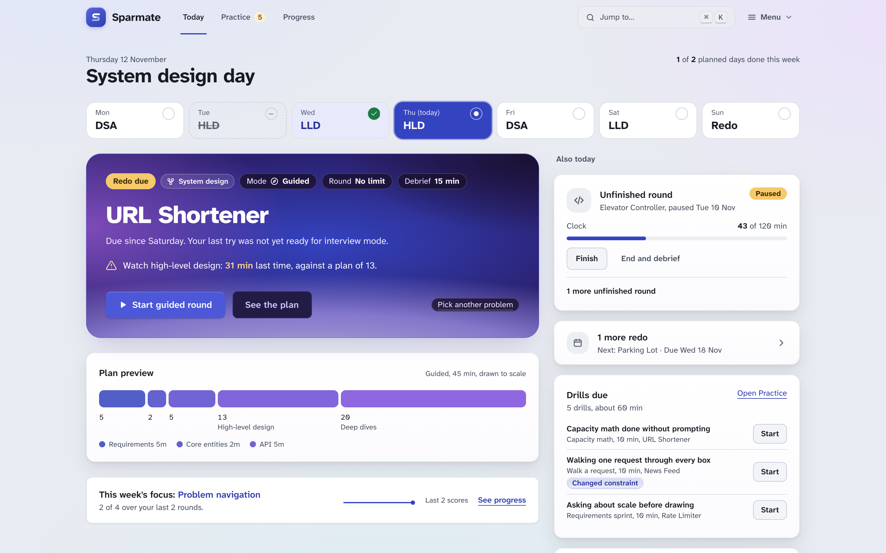 | 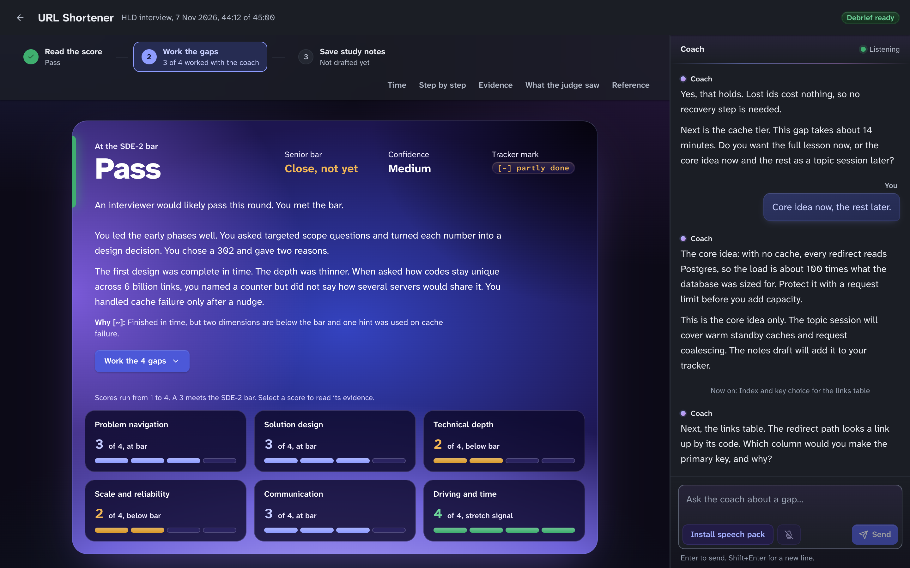 |

| HLD room                                                   | LLD room                                                               |
| ---------------------------------------------------------- | ---------------------------------------------------------------------- |
| 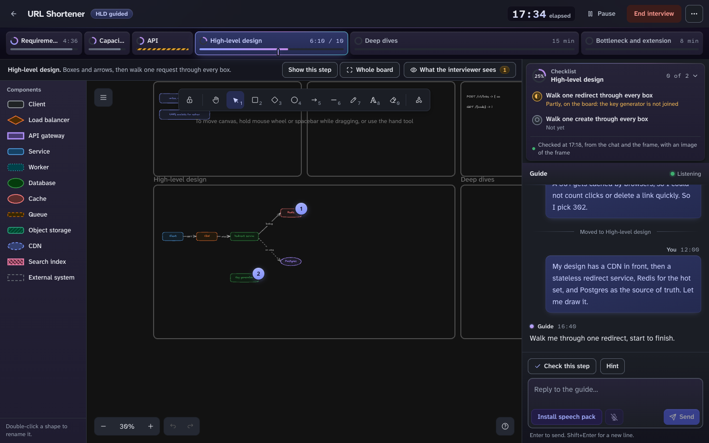 | 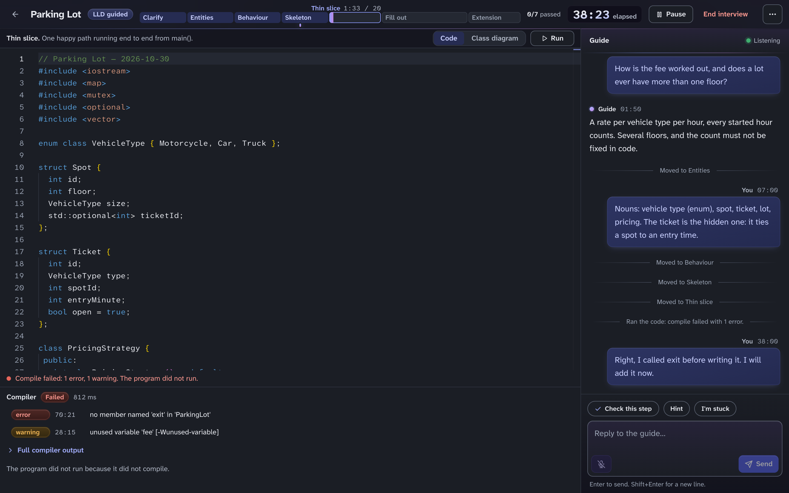 |

| Practice                                                             | Progress                                                                    |
| -------------------------------------------------------------------- | --------------------------------------------------------------------------- |
| 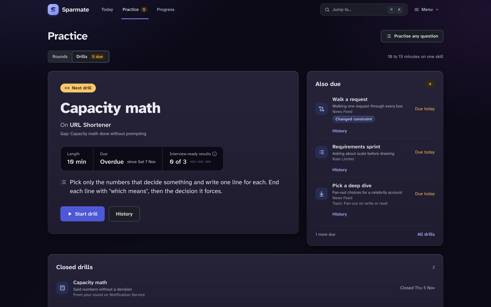 | 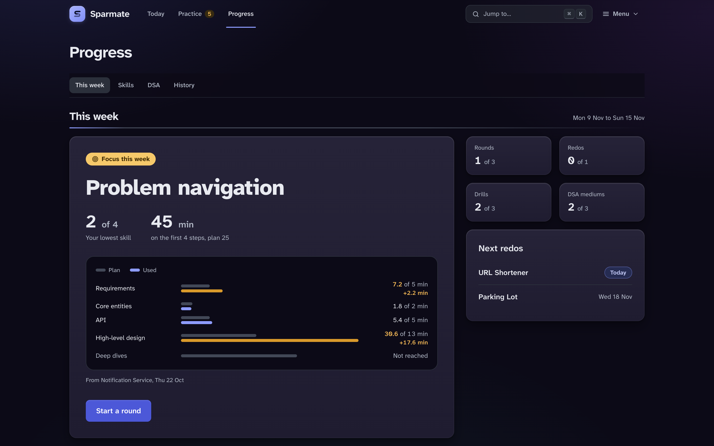 |

| Drill dialogue                                                                           | Drill history                                                                        |
| ---------------------------------------------------------------------------------------- | ------------------------------------------------------------------------------------ |
| 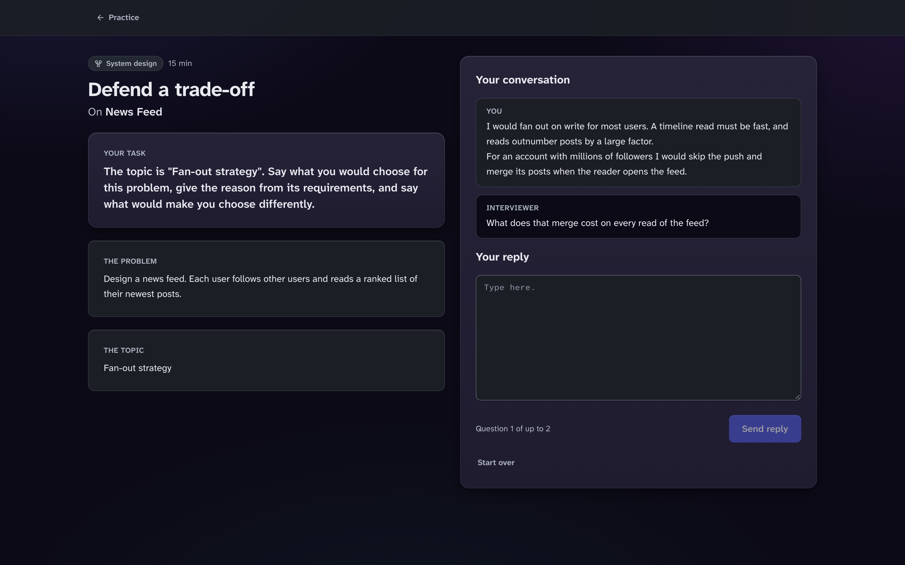 | 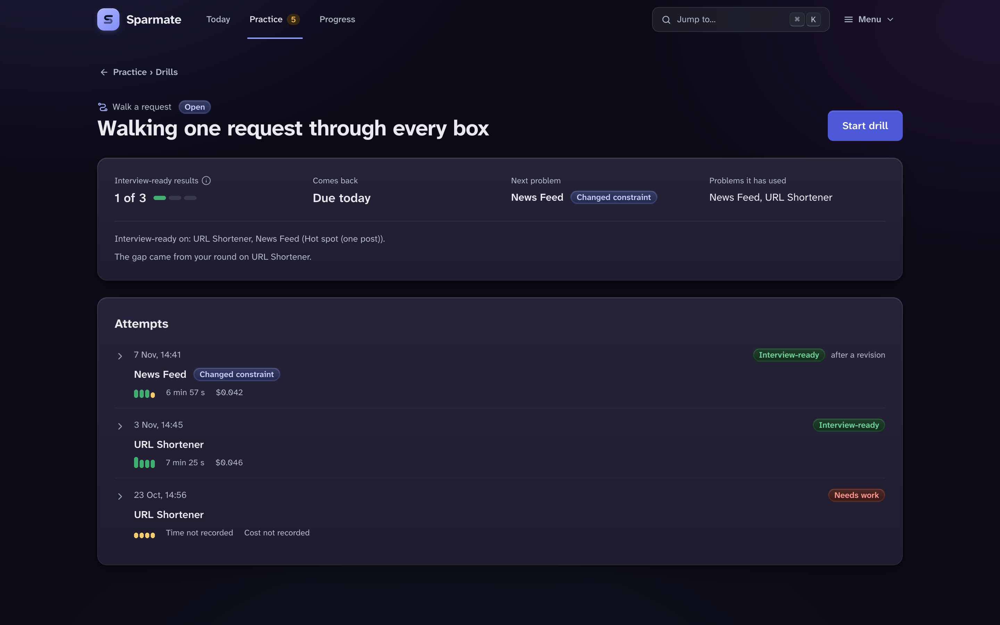 |

| Command palette                                                | Today on a phone                                                                                         |
| -------------------------------------------------------------- | -------------------------------------------------------------------------------------------------------- |
| 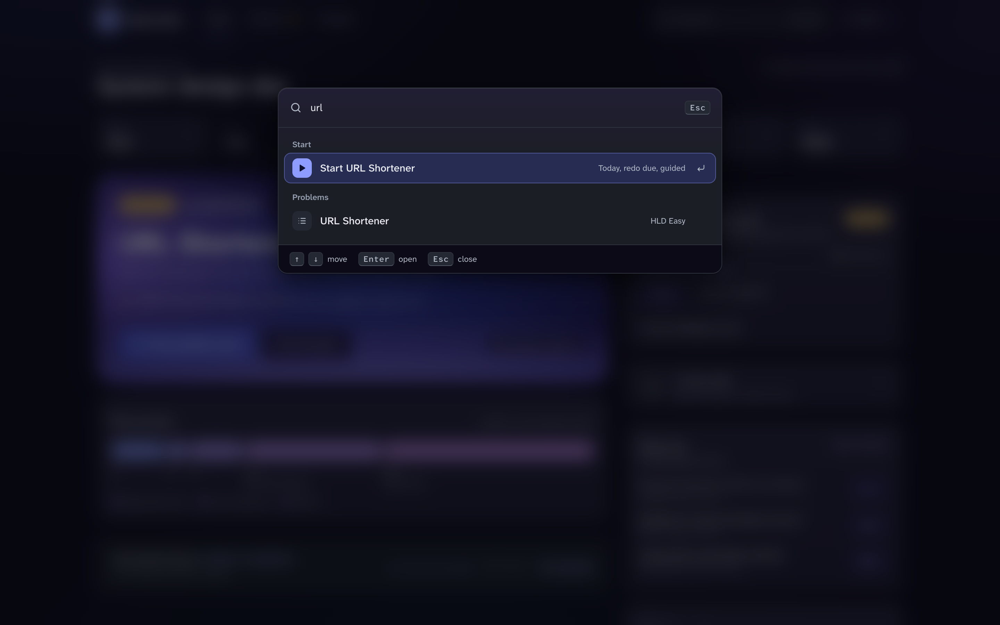 | 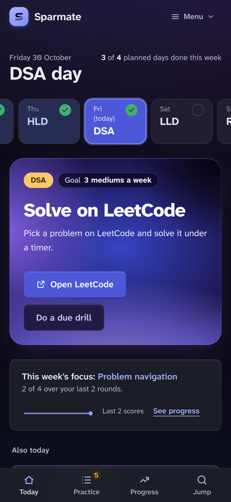 |

## Requirements

| Need                    | Details                                                                                                                                             |
| ----------------------- | --------------------------------------------------------------------------------------------------------------------------------------------------- |
| Node.js                 | 22.12 or newer.                                                                                                                                     |
| Operating system        | macOS is the main path. Linux works through the container (see below). Windows works through the container only.                                    |
| A Claude account        | `npm run setup` signs you in. You do not need to install Claude Code. The app talks to the model through the Claude Agent SDK and needs no API key. |
| A C++ compiler          | `clang++` at `/usr/bin/clang++`. On macOS, install the Xcode Command Line Tools with `xcode-select --install`.                                      |
| Chrome                  | Needed for voice input. It uses the browser's on-device speech recognition. Other browsers work for everything else.                                |
| Kokoro voice (optional) | Gives natural spoken replies. Without it, the app falls back to your system voice. Needs Python 3.11 or newer. See below.                           |

### Optional: Kokoro speech

`npm run setup` offers to install the Kokoro voice for you. It is a download of about 340 MB, and it needs Python 3.11 or newer. On macOS, `brew install python@3.12` gives you one.

Spoken replies use [Kokoro](https://github.com/thewh1teagle/kokoro-onnx) through a small Python worker. The app looks for these files in the Kokoro folder:

```
<kokoro folder>/.venv/bin/python
<kokoro folder>/kokoro-v1.0.onnx
<kokoro folder>/voices-v1.0.bin
```

The default Kokoro folder is `kokoro/` inside your data folder. Set `SPARMATE_KOKORO_HOME` to use another place. To set it up by hand, use Python 3.11 or newer:

```sh
python3.12 -m venv "$SPARMATE_KOKORO_HOME/.venv"
"$SPARMATE_KOKORO_HOME/.venv/bin/pip" install kokoro-onnx==0.4.7 soundfile==0.13.1
```

Then download `kokoro-v1.0.onnx` and `voices-v1.0.bin` from the [kokoro-onnx model-files-v1.0 release](https://github.com/thewh1teagle/kokoro-onnx/releases/tag/model-files-v1.0) into the same folder. `container/setup.sh` shows the exact downloads and checksums.

### Container route (Linux, Windows)

The `container/` folder runs the server in a Podman or Docker container. It includes the C++ toolchain, the sandbox and Kokoro. Your browser stays on your own machine. See [container/README.md](container/README.md).

```sh
./container/setup.sh
./container/start.sh
```

On Windows, run `.\setup.ps1` and then `.\start.ps1` from the `container` folder in PowerShell.

## Quick start

```sh
git clone https://github.com/hardikg2907/sparmate.git && cd sparmate
npm run setup
npm start
```

`npm run setup` installs the packages, checks for a C++ compiler, signs you in to Claude and offers to install the Kokoro voice. You can run it again at any time. It skips what is already done.

Open `http://127.0.0.1:4747`. If something is still missing, Today shows what it is and the command that fixes it.

The first start creates your study folder from `study-kit/` when it is missing or empty. By default it is `~/sparmate-study`. `npm start` builds the web page and then starts the server. Stop it with Ctrl+C.

### Setup options

Pass these after `--`, for example `npm run setup -- --no-kokoro`.

| Option           | What it does                             |
| ---------------- | ---------------------------------------- |
| `--yes`          | Answers yes to every question.           |
| `--no-kokoro`    | Never offers the Kokoro voice.           |
| `--skip-install` | Skips `npm ci` and only runs the checks. |

Without a terminal, setup asks nothing. It skips the Claude sign-in and the Kokoro voice unless you pass `--yes`.

### Optional settings

To change a default, copy the example file and edit it:

```sh
cp .env.example .env
```

In `.env`, set `STUDY_ROOT` to the folder you want for your study files. If you leave it unset, the app uses `~/sparmate-study`.

All settings in `.env`:

| Variable               | Default                           | Purpose                                                                                |
| ---------------------- | --------------------------------- | -------------------------------------------------------------------------------------- |
| `STUDY_ROOT`           | `~/sparmate-study`                | Your study folder.                                                                     |
| `DATA_DIR`             | `<STUDY_ROOT>/rounds`             | Sessions, settings, custom problems, drills and their attempts, logs and usage ledger. |
| `PORT`                 | `4747`                            | Server port.                                                                           |
| `SPARMATE_KOKORO_HOME` | `<DATA_DIR>/kokoro`               | Kokoro voice files.                                                                    |
| `SPARMATE_DENYLIST`    | `~/.config/sparmate/denylist.txt` | Extra words to keep out of your files (see Privacy).                                   |

## Your study folder

The study folder is yours. The app reads it and writes to it only in the ways listed here. You can keep it in its own private git repository. If you do, add `rounds/` to its `.gitignore`.

| Path          | What it is for                                                                                                                                                                        |
| ------------- | ------------------------------------------------------------------------------------------------------------------------------------------------------------------------------------- |
| `TRACKER.md`  | Your plan and progress. Each problem has a mark: `[ ]` not started, `[~]` taught but not yet recalled, `[x]` solved at the bar.                                                       |
| `REVIEW.md`   | Recall questions. The app adds new ones after a round, and the coach re-tests old ones.                                                                                               |
| `TEACHING.md` | The rules the coach follows when it teaches you. Edit it to change how you are taught.                                                                                                |
| `ABOUT_ME.md` | Your profile. It sets the bar for every round.                                                                                                                                        |
| `notes/`      | What you have learnt, one file per topic.                                                                                                                                             |
| `lld/`        | Your C++ attempts, as `lld/<problem>/attempt-<date>.cpp`. You can edit them in any editor and the page picks up the change.                                                           |
| `rounds/`     | Session transcripts, boards, scores, settings, the drill schedule (`drills.json`) and every drill attempt (`drill-attempts/`), and the usage ledger. The app writes here as you work. |

**The app writes study files only when you click Save.** That covers `TRACKER.md`, `REVIEW.md` and `notes/`. It also refuses to write if a file changed after it drafted the edit. The two exceptions are `rounds/` (round data) and the new `.cpp` file that an LLD round creates.

### Set your target in `ABOUT_ME.md`

One line sets the bar:

```
Target: SDE-2; stretch: senior; company: Series A to C startup
```

`stretch` is the level above your target, and `company` is the kind of employer. Each part is optional. A missing part keeps its default, which is the value shown above. The judge scores you against the target level.

The rest of the file is free text. You can list stacks you know well, for example Postgres, Kafka and Kubernetes. The coach then uses them as a bridge when it explains a new idea. The comparison is never the main lesson. Keep this file short and factual.

## A round, step by step

1. **Start the day's session.** Today picks it from your weekly plan, and a due redo of the day's track comes first. Or pick any problem in the Library.
2. **Choose a mode.** Interview mode is the real round. HLD gets 45 minutes, and LLD gets 120 (you can change both in Settings). There is no help on the clock. The interviewer adds the extension 10 minutes (HLD) or 15 minutes (LLD) before the end. In guided mode you ask the guide to check a step or give a hint.
3. **Work through the steps.** The step bar shows where you are. Click a step to move there.
   - **HLD:** draw on the whiteboard with the component palette and talk in the chat, typed or spoken. Each step has its own frame, and the frame comes into view when the step changes. "What the interviewer sees" shows how your diagram reads as text, so you can fix an unlabelled box or a loose arrow.
   - **LLD:** write C++ in the editor and press Run. Autocomplete is off on purpose. The file also lives in your study folder.
4. **Step checks.** A fast checker reads your work when you leave a step and when the round ends. In guided mode you can also press "Check this step". The guide then says "Passed" or "Not yet" with the one thing missing, and the checklist waits for the debrief. A step passes only when the checker finds at least half of its checklist in your chat, the step's frame or your written answer (one item for Deep dives, both for the machine coding Extension), so a pass rests on the same work the debrief reads. Interview mode shows none of this until the debrief.
5. **Pause or end.** Pause when you must step away. A round also pauses about a minute after you close its tab. "Discard round" deletes a round that has no debrief. "End interview" ends the round and starts the debrief.
6. **Debrief.** You get the verdict at your target and stretch levels, a score for each dimension with your own words quoted, and the gaps in order. You also get the time for each phase and each step's frame with what held and what is missing. For LLD, the tester's scenario results run against your code. "Reference answer" opens the model design.
7. **Coach.** The chat on the right teaches the gaps one at a time. Push back if a score looks wrong.
8. **Study notes.** "Draft study notes" proposes edits to `TRACKER.md`, `REVIEW.md` and `notes/`. Tick the ones you want and click Save.

## Privacy and safety

**Local only.** The server listens on `127.0.0.1`, so only your own machine can reach it. (The container route listens on all interfaces inside the container and publishes the port to your machine.)

**A deny-list keeps names out of your study files.** Before the app saves study notes, it checks the text and the file names against a list of terms. The list has two sources:

- the company name taken from the domain of your Claude account email, and the part of the address before the `@`
- any terms you add to `~/.config/sparmate/denylist.txt`, one per line (lines that start with `#` are comments)

A save that contains a listed term is refused. Log files redact listed terms. The list is built in memory and is never written anywhere. Every model prompt also tells the model not to mention your email or workplace.

**The model sees none of your Claude Code setup.** The model subprocess starts with no setting sources, so it loads none of your Claude Code settings or `CLAUDE.md` files. It has no tools, except that the roles that research a custom problem can search and fetch web pages. Nothing answers permission prompts, so any other tool is denied.

**C++ runs in a sandbox.**

|           | macOS                                                                                                                                 | Linux and the container                                                                          |
| --------- | ------------------------------------------------------------------------------------------------------------------------------------- | ------------------------------------------------------------------------------------------------ |
| Tool      | `sandbox-exec`                                                                                                                        | Bubblewrap (`bwrap`) with `prlimit`                                                              |
| Compiling | Reads only the system folders, the toolchain, the build folder and your one source file. Writes only to the build folder. No network. | A minimal root with system libraries and compilers. No home folder, no study folder, no network. |
| Running   | Writes only to the build folder, cannot read your home folder, no network, no child processes.                                        | The same private root, with no network and its own process space.                                |
| Limits    | File size and CPU time, plus a 1 GB memory cap that each program checks on itself every 2 ms.                                         | File size, CPU time, process count and a 1 GB address-space limit from `prlimit`.                |

Honest limits:

- On macOS the memory cap is checked, not enforced by the system. A program can pass 1 GB by a few tens of MB before it stops. A program that stops its own check is caught only by a slower poll of its resident memory.
- A program can still tell whether a file exists, for example with `__has_include`.

## Cost

Rounds use your Claude plan, like any Claude Code session. The default models are:

| Role                                     | Model                     | Effort                           |
| ---------------------------------------- | ------------------------- | -------------------------------- |
| Interviewer and guide                    | Claude Opus 5.5           | low (so replies come in seconds) |
| Judge and tester                         | Claude Opus 5.5           | high                             |
| Coach                                    | Claude Opus 5.5           | medium                           |
| Scribe (study notes and custom problems) | Claude Opus 5.5           | medium                           |
| Step checker                             | Claude Sonnet 5.5 (fixed) | low                              |
| Drill grader                             | Claude Sonnet 5.5         | medium                           |

To spend less, open Settings and switch the interviewer and the coach to Claude Sonnet 5.5. Keep the judge on Opus if you want the sharpest scoring.

The **Usage** page (`/usage`, linked in the header) shows tokens, cost, duration and role for every model call, with daily charts and breakdowns by problem, round, role and model. A Drills section shows what grading cost, and each problem splits round cost from drill cost. Each round has its own row, with its cost, and the row links to its debrief. Costs are API-equivalent prices. When the SDK does not report a cost, the app prices the call from its tokens, and the page shows a "≈" next to totals that include such estimates.

## Problems

Problem briefs live in `content/problems/hld/` and `content/problems/lld/`. A brief is the interviewer's private answer key. It holds:

- a frontmatter block with `id`, `track`, `title`, `difficulty`, `tags` and a `tracker` entry that names the matching bullet in `TRACKER.md` (LLD briefs also name an `lldFolder`)
- the opening prompt and the facts to reveal only when asked
- the expected requirements, capacity math or entities, and a reference design
- accepted alternatives, deep dives, curveballs or extensions
- the level bar and the common traps

To add a problem:

1. Copy a brief from the same track, such as `content/problems/lld/b3-lru-cache.md`, and change it. The file name must match `id`.
2. Add a matching bullet to your `TRACKER.md` (and to `study-kit/TRACKER.md` if you want it in the starter kit).
3. Check it:

   ```sh
   npx tsx scripts/check-problems.ts
   ```

   Pass a file path to check one brief. The script checks the frontmatter, the required sections, the tracker bullet and the length.

**Practise any question.** The Library can also turn a pasted interview question into a custom problem. An agent uses web search to ground real numbers and architectures, and a second pass checks the claims against sources. A setup card shows the sources, the checks and any corrections before you start. Custom problems are stored in your data folder, not in `content/`.

## Development

```sh
npm run dev          # Vite on :5173 with reload, and the server on :4747
npm test             # unit tests
npm run typecheck
SPARMATE_FAKE_AGENT=1 npm start   # no model calls: a scripted fake interviewer and judge
```

Fake mode is the safe way to try the app, change the interface or test the engine. It never calls a model.

These end-to-end scripts need no model. They start their own fake-mode server on a temporary copy of the study kit. Build the page first with `npx vite build`.

```sh
node scripts/e2e/ws-fake-round.mjs    # full rounds over the WebSocket
node scripts/e2e/ws-fake-pause.mjs    # pause and discard
node scripts/e2e/ui-tour.mjs          # screenshots of the main pages (needs Chrome)
node scripts/e2e/layout-check.mjs     # layout and scroll checks across screen sizes (needs Chrome)
```

The screenshots in `docs/screens/` come from the fixture pages. Rebuild them with `npx vite build && node scripts/capture-docs-screens.mjs` (needs Chrome).

`scripts/e2e/real-round.mjs --profile strong|weak|lld` runs a full round with a real model, so it uses your Claude plan. Run it only when you mean to.

More detail: [docs/SPEC.md](docs/SPEC.md) is the full specification, and [docs/DESIGN.md](docs/DESIGN.md) is the design guide. `content/prompts/` holds every model prompt as plain Markdown, and `content/rubrics/` holds the scoring rubrics. See [CONTRIBUTING.md](CONTRIBUTING.md) to send a change.

## License

[MIT](LICENSE).
